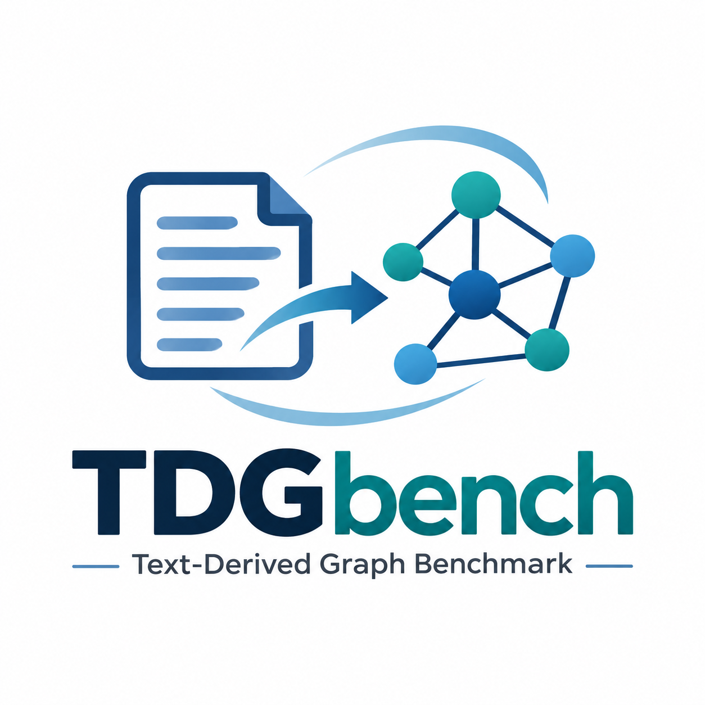

# TDGBench

<p align="center">
  
</p>

[](https://huggingface.co/datasets/othmanekabal/TDGBench)
[](https://arxiv.org/abs/2605.05476)

TDGBench is a reproducible Python benchmark for evaluating:

1. knowledge graph construction methods through downstream node classification;
2. GNN models on text-driven knowledge graphs (TDGs).

It provides a unified evaluation protocol, fixed data splits and common metrics
for two domains: **Biomedical** and **DBpedia**.

## Installation

```bash
pip install "tdg-bench"
```

## I. Knowledge graph construction methods

TDGBench compares graphs produced from the same domain under the same GNN,
features, splits and evaluation protocol.

### Available graphs

| Domain | Graph | Description |
|---|---|---|
| Biomedical | `GT2KG_tdg` | TDG generated by GT2KG from MedMentions |
| Biomedical | `kggen` | TDG generated by KGGen from MedMentions |
| Biomedical | `cg` | Curated UMLS-NCI reference graph built locally from a licensed UMLS database |
| DBpedia | `GT2KG_tdg` | TDG generated by GT2KG from the DBpedia corpus |
| DBpedia | `cg` | DBpedia reference graph |

### Evaluate a new graph generated from MedMentions

The graph can be provided as JSON, JSONL, CSV, TSV or XLSX. Tabular files must
contain `subject`, `predicate` and `object` columns.

```python
from tdg_bench import TDGBench

bench = TDGBench()

results = bench.unified_evaluation(
    dataset="biomed",
    graph_path="path/to/my_medmentions_graph.json",
    graph_name="my_kg_method",
    models=["GCN", "GAT", "RGCN"],
    initial_embedding_model="sentence-transformers/all-MiniLM-L6-v2",
)
```

TDGBench automatically uses the Biomedical Gold Standard, all predefined
splits, hidden dimensions and training seeds.

## II. GNN models on TDGs

TDGBench provides baselines evaluated on all benchmark graphs so researchers
can compare and develop new GNN architectures under the same protocol.

### Available baselines

| Model | Description |
|---|---|
| `GCN` | Graph Convolutional Network |
| `GAT` | Graph Attention Network |
| `RGCN` | Relational Graph Convolutional Network |
| `TransEGCN_conv` | TransE relation composition with mean aggregation |
| `TransEGCN_attn` | TransE relation composition with attention aggregation |
| `RotatEGCN_conv` | RotatE relation composition with mean aggregation |
| `RotatEGCN_attn` | RotatE relation composition with attention aggregation |

### Evaluate a GNN

Built-in baseline:

```python
from tdg_bench import TDGBench

bench = TDGBench()

result = bench.unified_evaluation(
    dataset="biomed",
    graph="GT2KG_tdg",
    model="GCN",
    initial_embedding_model="sentence-transformers/all-MiniLM-L6-v2",
)
```

TDGBench also accepts PyTorch Geometric convolution classes directly and
automatically builds the layers and node-classification head:

```python
from torch_geometric.nn import SAGEConv
from tdg_bench import TDGBench

bench = TDGBench()

result = bench.unified_evaluation(
    dataset="biomed",
    graph="GT2KG_tdg",
    model=SAGEConv,
    initial_embedding_model="sentence-transformers/all-MiniLM-L6-v2",
)
```

Convolutions requiring additional inputs can be supplied as a custom PyTorch
model. TDGBench keeps the same data, mini-batch training and evaluation
protocol.

## Paper and data

- Paper: [A Unified Benchmark for Evaluating Knowledge Graph Construction Methods and Graph Neural Networks](https://arxiv.org/abs/2605.05476)
- Data: [othmanekabal/TDGBench](https://huggingface.co/datasets/othmanekabal/TDGBench)

## Contact

Questions and contributions are welcome through
[GitHub Issues](https://github.com/OthmaneKabal/tdg-bench/issues).
